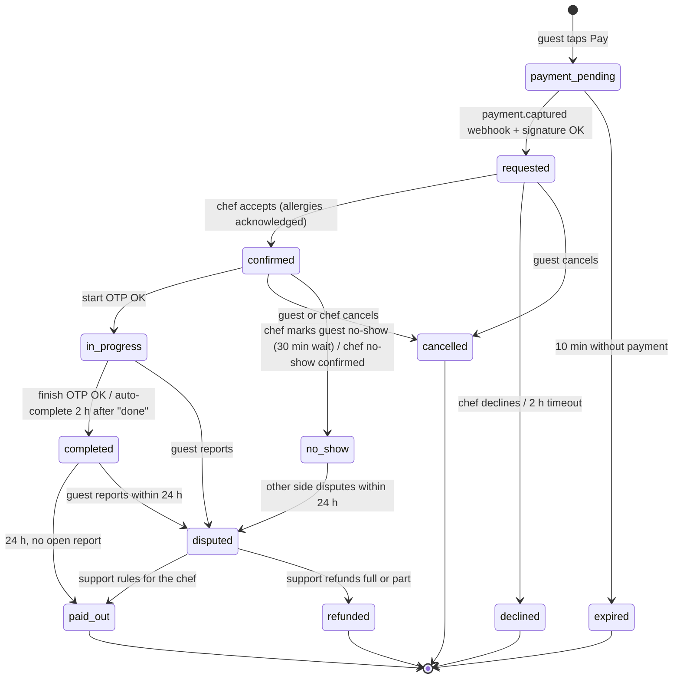

# Senzo — booking states

Every booking moves through **one state machine** in the Bookings module (`apps/api/src/modules/bookings`). A state changes only through the transitions below; each change is written to `booking_events` (actor, from, to, reason, time) in the same `batch()` as the booking update and an `outbox_events` row. Times and money rules come from `docs/business-rules.md`.

## States

| State | Meaning | Slot held? | Money |
| --- | --- | --- | --- |
| `payment_pending` | Guest is at checkout; Razorpay order created | Soft lock (10 min, Durable Object) | Nothing captured yet |
| `requested` | Paid; waiting for the chef (2 h) | **Yes** (unique index) | Captured; chef transfer created **on hold** |
| `confirmed` | Chef accepted | **Yes** | On hold |
| `in_progress` | Start OTP entered at the door | **Yes** | On hold |
| `completed` | Finish OTP entered, or auto-completed | No | On hold for 24 h (payout window) |
| `paid_out` | Hold released to the chef | No | Released (settles on the chef's payout run) |
| `declined` | Chef declined or didn't answer in 2 h | No | Full refund; transfer reversed |
| `cancelled` | Guest or chef cancelled before start | No | Refund/split per the cancellation policy |
| `no_show` | Guest or chef didn't show up | No | Per the no-show rules |
| `disputed` | A report is open; payout frozen | No | Hold kept until support decides |
| `refunded` | Final state after a dispute ends with a full or partial refund | No | Refund done; remaining share released |
| `expired` | Checkout never paid (soft lock ran out) | No | Nothing captured |

Happy path: `payment_pending → requested → confirmed → in_progress → completed → paid_out`.

## Transitions

| From | Event (API / timer) | To | Actor | Guards | Side effects |
| --- | --- | --- | --- | --- | --- |
| — | `POST /v1/bookings` | `payment_pending` | Guest | Quote valid; menu_total ≥ chef minimum; guests within limits; address in service area; slot free; soft lock acquired | Price snapshot saved; Razorpay order with Route transfer `on_hold: true` |
| `payment_pending` | Razorpay `payment.captured` (verified) | `requested` | System | Signature + webhook both OK; unique slot index accepts the row | Start Workflow (2 h accept timer); notify chef (push → SMS) |
| `payment_pending` | Soft lock timeout | `expired` | System | No capture | Release lock |
| `requested` | `POST /v1/partner/bookings/:id/accept` | `confirmed` | Chef | `allergies_ack = true`; chef live | Unlock address, chat, masked calls; create start OTP; schedule reminders (24 h, 2 h) |
| `requested` | `POST …/decline` or 2 h timer | `declined` | Chef / System | — | Full refund incl. convenience fee; reverse transfer; suggest 3 similar chefs (G17) |
| `requested` / `confirmed` | `POST /v1/bookings/:id/cancel` | `cancelled` | Guest | Policy window computed by server | Refund / split per policy; reverse or partially release transfer |
| `confirmed` | Chef cancels | `cancelled` | Chef | — | 100% refund + credit; chef strike *(see business rules Q4)* |
| `confirmed` | `POST …/on-my-way {eta}` | `confirmed` (sub-status `on_the_way`) | Chef | Within 4 h of the slot | Push to guest with ETA |
| `confirmed` | `POST …/start {otp, lat, lng}` | `in_progress` | Chef | OTP matches (≤ 5 tries), inside the booking window | Record location; flag if > 300 m |
| `confirmed` | `POST …/no-show` | `no_show` | Chef | ≥ 30 min after arrival time, door log present | Chef gets 50% of earnings; rest refunded; guest can dispute 24 h |
| `confirmed` | No start OTP 30 min after start time | `confirmed` (flag `possible_no_show`) | System | — | Call both sides; open the no-show flow (C14) |
| `in_progress` | `POST …/done` | `in_progress` (sub-status `awaiting_finish`) | Chef | — | Create finish OTP for the guest; start 2 h auto-complete timer |
| `in_progress` | `POST …/finish {otp}` or 2 h timer | `completed` | Chef / System | OTP matches, or timer fired with no open report | Start 24 h payout timer; ask both sides to rate |
| `in_progress` / `completed` | `POST /v1/bookings/:id/reports` | `disputed` | Guest | Before payout release | Freeze hold; support ticket `SR-`; call back in 15 min |
| `completed` | 24 h timer, no open report | `paid_out` | System | Ledger for the booking sums to zero | Release Route hold; ledger entries; invoices queued |
| `disputed` | Admin decision | `paid_out` / `refunded` | Support | Role Support (small refunds) or Finance | Full/partial refund; release the rest; audit log |

## Invariants (tests must enforce these)

1. A booking's state changes **only** through `bookings.transition()`; nothing else writes `bookings.state`.
2. One active booking (`requested`, `confirmed`, `in_progress`) per `chef_id + date + slot` — enforced by the unique partial index.
3. The amount charged is computed on the server from the price snapshot; the app never sends a price.
4. Every money movement writes balanced ledger entries; each booking's entries sum to zero.
5. Webhooks are idempotent: the same Razorpay event processed twice changes nothing the second time.
6. OTPs are stored hashed (HMAC), expire after the booking window, and lock after 5 wrong tries.
7. `booking_events` is append-only.

## Timers (Cloudflare Workflows, one per booking)

| Timer | Fires | Action |
| --- | --- | --- |
| Accept deadline | 2 h after `requested` | `declined` + refund + similar chefs |
| Reminders | 24 h and 2 h before the slot | Push to both (SMS if critical push not opened in 10 min) |
| No-show check | 30 min after start time without start OTP | Calls + no-show flow |
| Auto-complete | 2 h after chef taps "done" | `completed` unless a report is open |
| Payout release | 24 h after `completed` | `paid_out` unless disputed |
| Address hide | 24 h after the job | Chef loses access to the full address |
